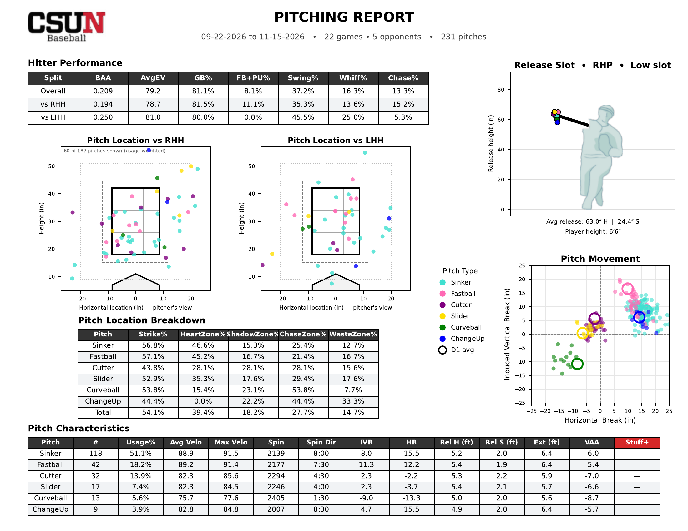

# Pitcher Reports

Automated internal pitcher reports built from TrackMan data. The script can create single game or cumulative reports for any pitcher who appears in the file in a matter of minutes.

Each page shows:
- **Hitter Performance:** BAA, exit velocity, batted-ball rates, swing / whiff / chase rates by batter handedness
- **Pitch Location vs RHH / LHH:** Strike rate and heart / shadow / chase / waste zone rates broken down by pitch type
- **Release Slot:** Silhouette scaled to the pitcher's height and arm slot showing the average release point of every pitch type in the pitcher's arsenal
- **Pitch Movement:** Traditional pitch movement plot with mid-major D1 averages for each pitch type and handedness for context
- **Pitch Characteristics:** Velocity, spin, movement, release, extension and approach angle

## Files

| File | What it does |
|---|---|
| `pitcher_report.py` | Builds the PDF: one page per pitcher appearing in the TrackMan file |
| `combine_trackman.py` | Merges several game files into one CSV for cumulative reports |

## How to run

Both scripts are written for Google Colab:

1. Open a new Colab notebook and paste in the script.
2. Run the cell and upload a TrackMan CSV when prompted (for `combine_trackman.py`, select all the game files at once).
3. The PDF (or combined CSV) downloads when it finishes.

If a pitcher isn't in `CSUN_ROSTER`, the script asks for his arm slot and height to create an accurate release point diagram.

**Requires:** pandas, numpy, matplotlib, Pillow (all preinstalled in Colab)

*Player names in this public version have been removed.*
